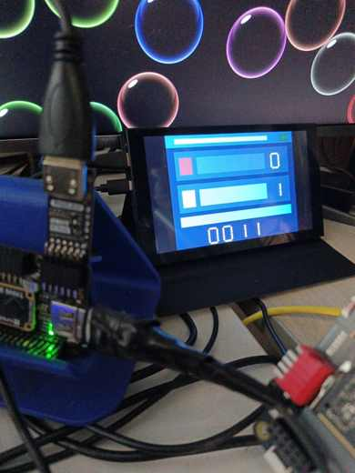
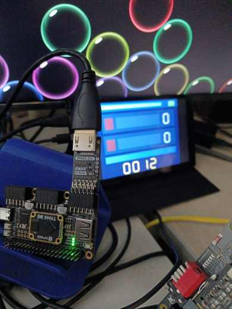

# PR25-USB-PHYSICAL-02 — USB D+/D− на FPGA с выводом через DVI

**Статус: VIDEO BOARD PASS / USB PHYSICAL DETECTION PASS, 15.11.2026.** Tang Primer 25K + Dock, без USB Host, без приёма HID и без UART.



## Реально полученный результат

Пользователь прислал фотографии **настоящей платы и монитора** после сборки и SRAM-программирования варианта **USB Attach Lite 02**. На одном кадре видно **верхняя панель D+ = 0, нижняя панель D− = 1, счётчик 0011**; на другом — **D+ = 0, D− = 0, счётчик 0012**. Это подтверждает реальный вывод показаний GPIO на HDMI-монитор и регистрацию изменений электрического состояния USB-линий. Контекст двух кадров согласуется с циклом подключения/отключения; последовательность событий подробно не протоколировалась, а независимые измерения D+/D− осциллографом не выполнялись.

| Компонент | Проверенный факт |
| --- | --- |
| FPGA / плата | Sipeed Tang Primer 25K (GW5A-25A) + Dock |
| Видеотракт | Gowin **DVI_TX_Top**, PMOD DVI, 640×480 — **BOARD VIDEO PASS** |
| USB-A D+ | FPGA **L6**, вход с подтяжкой к земле на Dock |
| USB-A D− | FPGA **K6**, вход с подтяжкой к земле на Dock |
| Счётчик | Изменился с `0011` на `0012` на двух фотографиях |
| Тип USB | При `D+=0,D−=1` вероятен Low Speed (1,5 Мбит/с) |
| USB Host / enumeration / VID/PID / клавиатура | **Не реализованы и не проверены** |
| Конфигурационная Flash | **Не используется**; только SRAM |



## Что сохранено

- [Собственный RTL](rtl/lab_top_usb_attach_lite.sv) — два синхронизатора, фильтр устойчивого состояния ~10 мс, счётчик изменений, индикация и 640×480 RGB-генератор
- [Исходный сценарий PowerShell](Build_USB_Attach_Lite02.ps1) — Gowin CLI build и опциональная загрузка **только SRAM**
- [Архив именно этого теста](source/PR25_USB_Attach_Lite02.zip), SHA256: `2f319e3b40462d779b3004b8fb7d41ec454ce8f89eea92992c7bd92f684f83b3`
- [Два фото аппаратной проверки](evidence/)
- [Обложка вертикального видео 9:16](video/video_cover_9x16.jpg)
- [Название и описание YouTube](video/VIDEO_RU.md)

**Точный рабочий `.fs` в этом коммите отсутствует.** Он был сгенерирован Gowin на операторском ПК в `%TEMP%\PR25_USB_Attach_Lite02\impl\pnr\pr25_usb_attach_lite02.fs`; его байты/хэш пока не переданы в беседу. Ни создавать заглушку `.fs`, ни публиковать другую сборку под видом проверенной нельзя. Для сохранения *именно* аппаратно проверенного файла предназначен [скрипт однократной публикации](Publish_Verified_FS.ps1), после проверки оператором локального файла и SHA256.

## Повторение эксперимента

Требуется Gowin EDA **1.9.9 Beta-4 Education**; выбранный битстрим должен соответствовать FPGA **GW5A-25A / GW5A-LV25MG121NC1/I0**. Оригинальный рабочий видеотракт берётся из зафиксированного учебного upstream [yuri-panchul/basics-graphics-music @ 817bd4d](https://github.com/yuri-panchul/basics-graphics-music/tree/817bd4dac8ab45d5c22bdd78b441bedb80672cd0), с зашифрованным IP Gowin **DVI_TX_Top** и неизменной раскладкой TMDS. Скрипт содержит исходные пути, клонирует upstream при необходимости в отдельный временный каталог, создаёт **отдельную** CST, в которой `GPIO[30] → L6` и `GPIO[31] → K6`, и вызывает `gw_sh.exe`.

**Не переставлять проверенный PMOD DVI.** USB-устройство подключать к штатному USB-A платы. Только малопотребляющую проводную мышь/клавиатуру. Не использовать внешние питания/переходники для D+/D−.

```powershell
$dir = "$env:TEMP\PR25_USB_Attach_Lite02_Package"
New-Item -ItemType Directory -Force $dir | Out-Null
$base = 'https://raw.githubusercontent.com/AIDevelopersMonster/Sipeed-FPGA/main/Tang-Primer-25K/Examples/PR25-USB-PHYSICAL-02'
Invoke-WebRequest "$base/rtl/lab_top_usb_attach_lite.sv" -OutFile "$dir/lab_top_usb_attach_lite.sv"
Invoke-WebRequest "$base/Build_USB_Attach_Lite02.ps1" -OutFile "$dir/Build_USB_Attach_Lite02.ps1"
& "$dir/Build_USB_Attach_Lite02.ps1" -ProgramSRAM
```

При `BUILD PASS` скрипт проверяет свежую `.fs` и записывает её **только в SRAM**. Успех синтеза/программирования — не замена наблюдения на мониторе. Оригинальная Flash и рабочая прошивка KonSol не изменяются на диске; SRAM заменяется до очередного выключения питания.

### Ограничения

Это *пассивный детектор* уровней двух входов, **не USB PHY** и **не USB Host-контроллер**. Он не отправляет пакеты, не опрашивает USB-дескрипторы и не читает клавиши. VBUS +5 В этим RTL **не измеряется**. Для двух фотографий можно говорить о смене электрических состояний и работе счётчика, не об успешном USB-перечислении.

**Лицензия:** собственный RTL и управляющие сценарии приведены для воспроизведения эксперимента; зашифрованный DVI_TX принадлежит Gowin и распространяется по условиям правообладателя. Подробнее [описание заводского IP](../../../ip/hdmi/gowin-dvi-tx/README.md).
